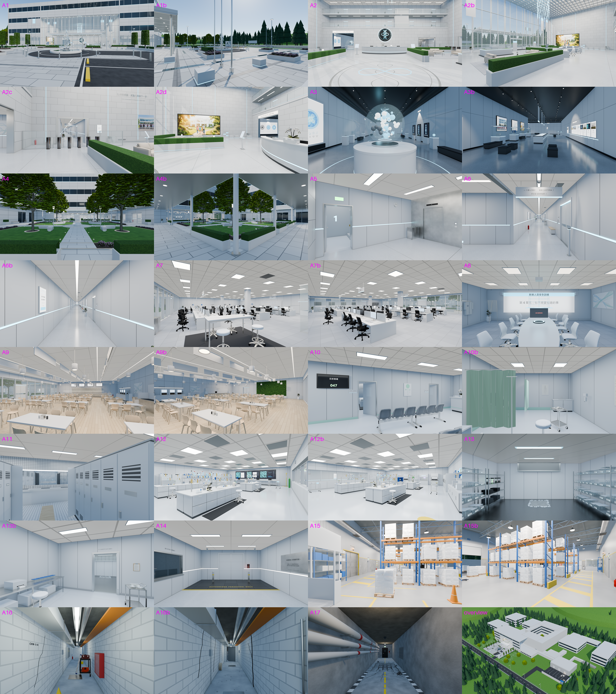

# text2scene

把一份場景文字描述變成可編輯的 Blender 場景，不需要任何參考圖。由 Claude 讀文字、決定需要哪些物件並為每個物件撰寫 prompt，FLUX.2 klein 4B 生成每個物件的乾淨 2D 圖，TRELLIS.2 轉成 3D 模型，最後由 Claude 透過 Blender MCP 在 Blender 裡直接建出建築、擺放模型、把空間填滿、打光。



## 流程

```
場景文字描述（空間的尺寸、材質、固定物件、光線）
  │  Claude 讀文字 → 空間配置、物件清單 → scene.json（每個物件一段 prompt）
  ▼
FLUX.2 klein 4B：prompt → 白底單一物件圖
  │  Claude 逐張審核，有缺點就改寫 prompt 再生成（每個物件至少 4 張）
  ▼
選出最佳的一張 → RMBG-2.0 去背
  │  TRELLIS.2（預設 512 管線）→ 已減面、帶貼圖的 GLB
  │  海報、螢幕畫面等平面影像不轉 3D，直接做成貼圖薄板
  ▼
Blender（由 Claude 透過 Blender MCP 操作，沒有建置腳本）
  │  依文字的尺寸與連接關係建出每個空間 → 匯入模型並擺位
  │  把看得到的空面填滿（分縫、標示、設備、道具）→ 程序化材質、燈光
  │  Claude 每一步都看畫面，最後逐項對照文字描述驗收
  ▼
scene.blend
```

完整的逐步操作說明在 [AGENT.md](AGENT.md)，那是寫給執行這條管線的 AI agent 看的手冊。

## 需求

- Windows 11 + WSL2 Ubuntu，NVIDIA 顯示卡 12 GB VRAM 以上（在 RTX 3060 上測試）
- WSL 記憶體 24 GB 以上，另加 swap
- [TRELLIS.2](https://github.com/microsoft/TRELLIS.2)，裝在 `~/TRELLIS.2`，conda 環境 `trellis2`
- [ComfyUI](https://github.com/comfyanonymous/ComfyUI)，裝在 `~/ComfyUI`，conda 環境 `comfyui`
- [FLUX.2 klein](https://github.com/black-forest-labs/flux2) 4B 的模型檔，放在 `~/ComfyUI/models/`：`flux-2-klein-4b-fp8.safetensors`、`qwen_3_4b.safetensors`、`flux2-vae.safetensors`（下載位置見 [ComfyUI 官方教學](https://docs.comfy.org/tutorials/flux/flux-2-klein)）
- Blender 5.x，並安裝 MCP for Blender 外掛、在 agent 端接上 Blender MCP；整個流程中 Blender 要開著

路徑若與上述不同，需要修改 `pipeline/` 內的腳本與 `AGENT.md`。

## 使用方式

建議的用法是讓 Claude Code 之類的 agent 依照 `AGENT.md` 執行，因為列物件、寫 prompt、審圖、組裝場景都需要判斷：

> 依照 AGENT.md，只看 `<場景描述.md>` 的文字，做出「區域 A」的 Blender 場景。

文字描述寫得越具體越好：每個空間的寬 × 深 × 高、出入口通往哪裡、地面 / 牆面 / 天花的材質、固定物件靠哪面牆、標示文字的確切內容、光源。沒寫到的部分由 agent 自行決定。

2D 圖與 3D 模型的部分也可以手動分兩段執行（批次模式，同一個 prompt 換種子生成 4 張，不做 prompt 迭代），前提是 `scene.json` 已經寫好：

```powershell
.\pipeline\run_all.ps1 generate    # 候選圖 + 對照表
# 看 work\objects\<id>\sheet.png，寫 work\selection.json
.\pipeline\run_all.ps1 models      # 去背 + TRELLIS
```

`run_all.ps1` 是依手動步驟整理的，尚未完整執行過一次。Blender 場景沒有腳本可跑：模型產生後，請 agent 依 `AGENT.md` 步驟 5 透過 Blender MCP 組裝。

## 輸出

| 檔案 | 內容 |
|---|---|
| `scene.blend` | 完整場景，貼圖已打包；每個空間有一台第一人稱相機 `Cam_<空間>`。它是由 agent 直接在 Blender 裡建的，沒有可重跑的建置腳本 |
| `work/renders/view_<空間>.png` | 各空間的第一人稱渲染 |
| `work/renders/view_overview.png` | 全區俯瞰 |
| `work/renders/contact_sheet.png` | 以上全部拼成一張 |
| `work/objects/<id>/` | 每個物件的候選圖、prompt 紀錄、去背圖、GLB |

## 效能參考（RTX 3060 12 GB，模型放在 HDD）

| 階段 | 耗時 |
|---|---|
| FLUX.2 klein 4B，1 MP、4 步 | 冷啟動首張約 2–4 分鐘，之後約 15 秒/張 |
| TRELLIS.2（512 管線） | 載入約 5 分鐘，每個物件 1–4 分鐘；`1024_cascade` 更久 |
| Blender 組裝（agent 透過 MCP 逐步建模、檢查、調整） | 視範圍而定，十幾個空間的區域需要數小時；單次渲染約 15 秒 |

## 已知限制

- **透明物件**：TRELLIS.2 會把玻璃重建成不透明的白色實體，玻璃容器、玻璃翼板要在 Blender 用玻璃材質建，內容物另外生成。
- **文字**：TRELLIS.2 會把文字重建成亂碼，所以海報、螢幕畫面用貼圖薄板，標示文字用 Blender 文字物件。
- **姿態**：生成的模型是一體的，無法事後調整可動部位（例如堆高機的貨叉高度）；需要特定姿態時要在 prompt 寫明，或拆成多個物件。
- **細節精度**：TRELLIS 預設用 512 管線並減面到數萬面，適合場景道具；需要近看的物件可以逐一改用 `1024_cascade`，但在 12 GB VRAM 上實心方塊與枝葉類可能因記憶體不足而失敗。
- **物件是模型自己想像的**：沒有參考圖，同一段 prompt 換種子會得到不同設計；風格一致性靠 prompt 與審核維持。
- **場景不可重現**：格局、擺位、材質、燈光是 agent 每次現做的，同一份文字跑兩次結果不會相同；`scene.blend` 是唯一的成果，請自行備份。
- **VRAM**：ComfyUI 與 TRELLIS 不能同時執行。
- **磁碟**：模型合計約 30 GB；WSL 內的 `df` 顯示的是虛擬磁碟上限，請以 Windows 磁碟的實際剩餘空間為準。

## 授權注意

- FLUX.2 klein 只使用 **4B（Apache 2.0）**；9B 是非商用授權，腳本裡沒有提供。
- TRELLIS.2、RMBG-2.0 各有自己的授權條款，使用前請自行確認。
- 貼圖只從 [Poly Haven](https://polyhaven.com) 下載，全部為 CC0。
- 場景文字描述與其中的設定內容，著作權由提供者自行負責。
